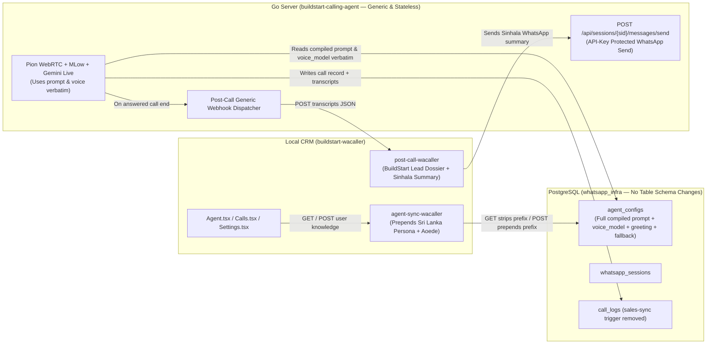

# Calling Agent Decoupling & Local CRM Migration Plan

**Status:** Draft / Pending Approval (No code, database, or server changes made yet)  
**Target Repositories:**
- `buildstart-calling-agent` (Go VoIP & WhatsApp Gateway)
- `buildstart-wacaller` (Local Sri Lanka CRM & `-wacaller` Edge Functions)

---

## 1. Objective & Scope Rules

### Goal
Decouple all Sri Lanka / Sinhala / BuildStart-specific business logic, system prompts, lead intelligence, and hardcoded phone/brand assumptions **out of the Go server (`buildstart-calling-agent`)** and move them cleanly back into the **Local CRM (`buildstart-wacaller`)**, so that:
1. The **Local CRM** continues working identically (and even better, fixing the retired `gemini-2.5-flash` post-call dossier bug) with zero downtime for existing local clients.
2. The **Go server** becomes a clean, region-agnostic, platform-independent Voice & WhatsApp Gateway ready for **both** the Local CRM and a future Global Platform.

### Strict Constraints
- **Do NOT implement anything for the Global CRM yet.**
- **Only create/modify Supabase Edge Functions ending with `-wacaller`** (never touch any of the ~470 other tenant edge functions on the shared Supabase host).
- **Do NOT alter any PostgreSQL table schemas** in `wacaller_customization`, `whatsapp_infra`, or any other schema (only drop the `sales-sync-wacaller` trigger originally created by `buildstart-wacaller/db/create_sales_sync_trigger.sql`, and perform a data-only backfill on existing `whatsapp_infra.agent_configs` rows).
- **Zero disruption to other services or containers** running on the shared Hetzner VPS (`178.104.127.220`).

---

## 2. Target Architecture After This Migration



---

## 3. Current Coupling Audit (Verified Locations)

### A. In `buildstart-wacaller`
1. **External Sales Sync (To Be Removed Entirely)**:
   - `supabase/functions/sales-sync-wacaller/index.ts`
   - `supabase/config.toml` lines 54–58 (`[functions.sales-sync-wacaller]`)
   - `db/create_sales_sync_trigger.sql` (created `whatsapp_infra.trigger_sales_sync_webhook()` and trigger `on_call_ended_sales_sync` on `whatsapp_infra.call_logs`)
   - Live Hetzner directory: `/root/supabase/supabase/docker/volumes/functions/sales-sync-wacaller`
   - Live PostgreSQL trigger: `on_call_ended_sales_sync` on `whatsapp_infra.call_logs` (currently fires `pg_net` HTTP POST on every call ending with `duration > 30`).

2. **Knowledge & Prompt Sync**:
   - `supabase/functions/agent-sync-wacaller/index.ts` currently saves `business_prompt` raw (knowledge/FAQs only) and defaults `voice_model` to `"models/gemini-3.1-flash-live-preview"`.
   - `frontend/src/pages/Agent.tsx` tells local users not to include generic voice/pacing rules because the server handles them.
   - Currently, the 2 rows in `whatsapp_infra.agent_configs` (`5cb1756f-43c9-4707-a7bc-cc8d2b7dc4f5` and `c300eeab-e6c2-474d-bccd-f2ca9fd05d7d`) do **not** contain the Sri Lanka persona prefix and have `voice_model = 'models/gemini-3.1-flash-live-preview'`.

### B. In `buildstart-calling-agent`
| Hardcoded Item | File & Line(s) | Current Behavior | Target Decoupled Behavior |
| :--- | :--- | :--- | :--- |
| Sri Lanka sales `basePrompt` | `cmd/server/session.go:75-90` | Prepends Sri Lanka consultant persona + Singlish/Tanglish rules + `"හරි"`, `"சரி"` | Pass `cfg.BusinessPrompt` verbatim to Gemini Live |
| Voice override to `"Aoede"` | `cmd/server/session.go:69-72` | Forces `"Kore"` and `models/...` to `"Aoede"` | Use `cfg.VoiceModel` directly; only fallback to `"Aoede"` if empty or legacy `models/`/`dialog-`/`piper-` prefix |
| Hardcoded Sinhala fallback text | `cmd/server/session.go:562-568` | Sends default Sinhala text if `FallbackMessage` is empty | Send missed-call fallback **only** when `cfg.FallbackMessage != ""` |
| Unused Sinhala/English callback greeting | `cmd/server/session.go:579-584` | Builds unused `callbackGreeting` string | Remove dead local strings; use `cfg.GreetingMessage` cleanly |
| BuildStart Lead Dossier & Sinhala WhatsApp summary | `cmd/server/crm_lead.go:1-172` | Hardcodes `"Buildstart AI"`, `Starter (LKR 6,990)`, calls retired `gemini-2.5-flash` (currently 404), sends Sinhala summary via `whatsmeow` | Remove Gemini/BuildStart logic from Go; fire generic webhook `POST_CALL_WEBHOOK_URL` on answered call end |
| Empty greeting fallback `"හෙලෝ"` & Sinhala log | `internal/agent/gemini_live.go:104-106, 554` | Defaults empty greeting to `"හෙලෝ"` and logs `"triggering initial greeting in Sinhala"` | Default empty greeting to neutral `"Hello"` and log `"pre-synthesizing initial greeting"` |
| Hardcoded test LID `17609835688032 -> 94765225044` | `cmd/server/session.go:230,290,370,454`, `broker.go:63,229`, `sessionstore.go:122,130`, `internal/wa/socket.go:138` | Hardcodes one test user's LID-to-PN mapping | Remove hardcoded LID everywhere (dynamic `whatsmeow_lid_map` handles LID resolution) |
| Sri Lanka `0xx -> +94` phone formatting | `cmd/server/broker.go:67-72` | Assumes 10-digit `0...` numbers are Sri Lanka `+94` | Use clean generic international `+<digits>` formatting in Go |
| Hardcoded domain / MinIO fallbacks | `cmd/server/broker.go:264,365`, `httpapi.go`, `recorder.go:251-270` | Defaults to `buildstart-calling-agent.buildstart.io` and hardcoded MinIO creds/URL | Read from `.env` (`PUBLIC_HOST`, `MINIO_*`) cleanly |

---

## 4. Detailed Step-by-Step Migration Plan

### Phase 1: Remove `sales-sync-wacaller` Entirely (Solves Trigger Coupling)
1. **Drop PostgreSQL Trigger First** (prevents `pg_net` 404 errors on call completion):
   ```sql
   DROP TRIGGER IF EXISTS on_call_ended_sales_sync ON whatsapp_infra.call_logs;
   DROP FUNCTION IF EXISTS whatsapp_infra.trigger_sales_sync_webhook();
   ```
   *(This only removes the webhook trigger added by `buildstart-wacaller/db/create_sales_sync_trigger.sql` and leaves all table structures intact.)*
2. **Remove Repo Artifacts (`buildstart-wacaller`)**:
   - Delete `supabase/functions/sales-sync-wacaller/`.
   - Delete `db/create_sales_sync_trigger.sql`.
   - Remove the `[functions.sales-sync-wacaller]` section from `supabase/config.toml`.
   - Update `buildstart-wacaller/ARCHITECTURE.md` to remove `sales-sync-wacaller` references.
3. **Remove Deployed Function on Hetzner VPS**:
   - Delete `/root/supabase/supabase/docker/volumes/functions/sales-sync-wacaller` (touching no other folders).

---

### Phase 2: Move Local System Prompt, Voice & Fallback Defaults to `agent-sync-wacaller`
1. **Define Local Persona Prefix in `supabase/functions/agent-sync-wacaller/index.ts`**:
   - Store the exact current `basePrompt` (`LOCAL_BASE_PROMPT`) inside `agent-sync-wacaller`, bounded by a clean internal marker (e.g., `<!-- BUILDSTART_LOCAL_PERSONA_END -->`) or exact prefix matching:
     ```ts
     const LOCAL_BASE_PROMPT = `You are a trusted voice sales consultant in Sri Lanka — calm, warm, confident, and genuinely helpful. You are not an FAQ bot, but you never sound pushy, overexcited, theatrical, or aggressive. Guide the call naturally, understand the customer, recommend the right fit, and agree on a useful next step.

     VOICE AND DELIVERY
     Speak at a relaxed, steady pace with a friendly Sri Lankan tone. Use moderate energy and restrained enthusiasm. Keep your pitch and volume even. Do not shout, rush, exaggerate, use hype, or sound like a scripted salesperson. Pause naturally, listen carefully, and acknowledge the customer's answer before asking the next question.

     LANGUAGE
     Speak natural Sinhala, Tamil, English, or authentic Singlish and Tanglish code-switching, matching the customer. If they mix languages, mix back naturally. If you did not hear clearly, ask them to repeat — never guess.

     HARD RULES
     1. Usually end with one relevant open question or a gentle two-option choice, but do not interrogate.
     2. Keep each spoken sentence under about 20 words and use 1–2 sentences per turn. Use natural connectors sparingly: "හරි", "ඇත්තටම", "නේද?", "சரி".
     3. Never dump feature lists. Give one relevant benefit, then ask.

     BUSINESS KNOWLEDGE (STRICTLY ADHERE TO THIS):
     `;
     ```
2. **Preserve Clean UX in `Agent.tsx` (No Frontend Breaks)**:
   - **On `POST` (`agent-sync-wacaller`)**:
     - Strip any accidental duplicate prefix from the incoming `business_prompt`, then save `LOCAL_BASE_PROMPT + userPrompt` into `whatsapp_infra.agent_configs.business_prompt`.
     - Set `voice_model` to `voice_model && !voice_model.startsWith("models/") ? voice_model : "Aoede"` (hardcoding `"Aoede"` for Local CRM).
     - Set `fallback_message` to `fallback_message || "ආයුබෝවන්! ඔබ අප අමතන්නට උත්සාහ කළ බව දුටුවෙමි. අපගේ AI හඬ සහායකයා මේ මොහොතේම ඔබව නැවත අමතනු ඇත."` if empty (or preserve explicit empty if desired — wait: currently `Agent.tsx` expects fallback message to work out-of-the-box if left blank, so defaulting empty `fallback_message` on `POST` or keeping a default keeps exact parity).
   - **On `GET` (`agent-sync-wacaller`)**:
     - Strip `LOCAL_BASE_PROMPT` from `data.business_prompt` before returning JSON to `Agent.tsx`, so Local CRM operators still only see and edit their Business Knowledge & FAQs in the textarea.
3. **Backfill Existing Local Rows in `whatsapp_infra.agent_configs`** (Data-only `UPDATE`, zero schema change):
   - Prepend `LOCAL_BASE_PROMPT` to the 2 existing rows (`5cb1756f-43c9-4707-a7bc-cc8d2b7dc4f5` and `c300eeab-e6c2-474d-bccd-f2ca9fd05d7d`) if not already prefixed, and set `voice_model = 'Aoede'`.
   - This guarantees existing live agents behave 100% identically the instant the updated Go server starts.

---

### Phase 3: Migrate Post-Call Lead Intelligence & Messaging into `post-call-wacaller`
1. **Add Authenticated Send-Message Endpoint to Go (`buildstart-calling-agent`)**:
   - In `cmd/server/httpapi.go`: add `POST /api/sessions/{sid}/messages/send` and `POST /api/v1/sessions/{sid}/messages/send`:
     - Request JSON: `{ "to": "94769652770@s.whatsapp.net", "text": "..." }` (resolves `@lid` via `s.mgr.store.getPNForLID` if needed, just like `crm_lead.go` does today).
     - Security: require `X-Api-Key` or `Authorization: Bearer <GO_API_KEY>` matching `os.Getenv("GO_API_KEY")`. If `GO_API_KEY` is configured, reject missing/invalid keys with `401 Unauthorized`.
     - Synchronous/reliable send helper returning `{ "success": true, "message_id": "..." }`.
2. **Replace `crm_lead.go` in Go with Generic Post-Call Webhook (`cmd/server/webhook_dispatch.go`)**:
   - Remove all BuildStart pricing, Gemini HTTP calls, and Sinhala prompts from Go (`crm_lead.go`).
   - When an answered call finishes (`isTrulyAnswered && len(rec.Transcripts) >= 2`), if `POST_CALL_WEBHOOK_URL` is configured:
     - Dispatch an async `POST` with timeout (e.g. 15s) and optional `X-Webhook-Secret: <POST_CALL_WEBHOOK_SECRET>` header containing:
       ```json
       {
         "event": "call.completed",
         "call_id": "...",
         "session_id": "...",
         "business_id": "...",
         "caller_number": "+94...",
         "peer_jid": "...",
         "direction": "inbound",
         "duration_seconds": 45,
         "transcripts": [...]
       }
       ```
3. **Create `buildstart-wacaller/supabase/functions/post-call-wacaller/index.ts`**:
   - Follows `-wacaller` suffix rule and is registered in `supabase/config.toml` (`verify_jwt = false`, verified via `POST_CALL_WEBHOOK_SECRET` header).
   - Verifies `business_id` belongs to Local CRM (checks `wacaller_customization.business_settings` / `user_roles`) so future Global CRM businesses are cleanly ignored if routed differently.
   - Formats the transcript and calls Gemini (via `GEMINI_API_KEY` or the existing `OPENROUTER_API_KEY` / `LOVABLE_API_KEY` already configured in `supabase-edge-functions`) using a working model (fixing the current `gemini-2.5-flash` 404!).
   - Generates the BuildStart Sinhala Lead Dossier JSON (`whatsapp_summary_sinhala`, `deal_temperature`, `lead_score`, `recommended_plan`, etc.).
   - Logs the dossier and, after a short 3s pause, calls `${GO_SERVER_URL}/api/sessions/${session_id}/messages/send` with `GO_API_KEY` to deliver `whatsapp_summary_sinhala` to the caller.

---

### Phase 4: Clean Up Remaining Local Hardcodes in `buildstart-calling-agent`
1. **`cmd/server/session.go`**:
   - Remove `basePrompt`; pass `cfg.BusinessPrompt` directly to `agent.NewGeminiLiveAgent(...)`.
   - Use `cfg.VoiceModel` directly (only map empty or legacy `models/`/`dialog-`/`piper-` strings to `"Aoede"`, allowing `"Kore"` and all Gemini Live voices to work cleanly).
   - In `scheduleAutoCallback`:
     - Respect `AUTO_CALLBACK_ENABLED` env flag (default `"true"` if unset so Local CRM stays identical without schema edits).
     - Remove the hardcoded Sinhala fallback string; only call `s.sendWhatsAppMessage(peer, agentCfg.FallbackMessage)` when `agentCfg.FallbackMessage != ""`.
     - Remove unused `callbackGreeting` hardcoded Sinhala/English logic.
   - Remove all 4 occurrences of hardcoded `17609835688032 -> 94765225044`.
2. **`internal/agent/gemini_live.go`**:
   - Change empty fallback greeting `"හෙලෝ"` $\rightarrow$ `"Hello"`.
   - Update log string `"triggering initial greeting in Sinhala upon call pickup"` $\rightarrow$ `"pre-synthesizing initial greeting"`.
3. **`cmd/server/broker.go`, `cmd/server/sessionstore.go`, `internal/wa/socket.go`**:
   - Remove hardcoded `17609835688032` checks in all 3 files.
   - In `broker.go` `formatPhoneNumber`: remove `+94` country-specific splitting and `0xxxxxxxxx -> +94` rewriting; normalize cleanly as international `+<digits>` (keeping the 14+ digit `LID: <id>` guard when no PN mapping exists).
   - Use `PUBLIC_HOST` env var (falling back to `r.Host`) for audio stream URLs in `broker.go` and `httpapi.go`.
4. **`cmd/server/recorder.go`**:
   - Externalize `MINIO_*` settings cleanly via environment variables on the Hetzner VPS `.env`.
5. **Unit Tests**:
   - Add/update Go tests in `cmd/server` / `internal/voip/...` to verify:
     - `POST /api/sessions/{sid}/messages/send` auth enforcement (401 on missing/bad key).
     - Generic prompt & voice pass-through (no Sri Lanka prefix injected by Go, `"Kore"` not overridden).
     - E.164 phone formatting in `formatPhoneNumber`.

---

### Phase 5: Safe Deployment Sequence

Execute strictly in this order so no live call or CRM screen breaks at any point:

1. **Database Trigger Cleanup**:
   - Run `DROP TRIGGER IF EXISTS on_call_ended_sales_sync ON whatsapp_infra.call_logs;` and `DROP FUNCTION IF EXISTS whatsapp_infra.trigger_sales_sync_webhook();`.
2. **Deploy `-wacaller` Edge Functions**:
   - Deploy updated `agent-sync-wacaller` and new `post-call-wacaller` into `/root/supabase/supabase/docker/volumes/functions/`.
   - Add `GO_API_KEY`, `POST_CALL_WEBHOOK_SECRET`, and `GO_SERVER_URL` to `/root/supabase/supabase/docker/.env` (verify before restarting `supabase-edge-functions` so no other tenant env vars are affected).
   - Verify no non-`-wacaller` directories were touched.
3. **Backfill `whatsapp_infra.agent_configs` Data**:
   - Run a one-time SQL update on the 2 existing rows in `whatsapp_infra.agent_configs` to prepend `LOCAL_BASE_PROMPT` and set `voice_model = 'Aoede'`.
   - Verify via `agent-sync-wacaller` `GET` that `Agent.tsx` still displays only the business knowledge (prefix cleanly stripped).
4. **Update Go Server Config & Deploy Binary**:
   - Add `GO_API_KEY`, `POST_CALL_WEBHOOK_URL=http://127.0.0.1:8000/functions/v1/post-call-wacaller` (or public HTTPS gateway URL), `POST_CALL_WEBHOOK_SECRET`, `MINIO_*`, and `PUBLIC_HOST` to `/opt/buildstart-calling-agent/.env`.
   - Verify `GET http://127.0.0.1:8080/api/calls` shows zero active calls.
   - Build static binary, back up existing binary (`buildstart-calling-server.bak`), swap binary, and restart `buildstart-calling-agent.service`.
5. **Commit & Push Both Repositories**:
   - `buildstart-wacaller` $\rightarrow$ `origin/master` (triggers Vercel build cleanly; verify no `AGENTS.md` or `.agents/` committed).
   - `buildstart-calling-agent` $\rightarrow$ `origin/development` (and `git pull` on `/opt/buildstart-calling-agent`).

---

## 6. Post-Migration Verification Checklist

- [ ] **No sales-sync errors**: Confirm `on_call_ended_sales_sync` trigger is gone and `sales-sync-wacaller` directory is removed cleanly.
- [ ] **Local CRM UI parity**: Open `Agent.tsx` in browser; confirm the prompt textarea shows only the business knowledge/FAQs (not `LOCAL_BASE_PROMPT`), and saving updates `whatsapp_infra.agent_configs` with `LOCAL_BASE_PROMPT` + `"Aoede"`.
- [ ] **Inbound & Outbound Voice Call**: Place a test call to the linked local number (`94740979087`) from `94769652770`; confirm greeting, Sinhala/Singlish/English/Tamil natural conversation, and auto-callback behave identically to before.
- [ ] **Post-Call Webhook & Follow-up**: After an answered conversation ($\ge 2$ transcript turns), verify Go posts to `post-call-wacaller`, `post-call-wacaller` generates the dossier cleanly without 404, and sends the WhatsApp summary via Go's authenticated `/messages/send` endpoint.
- [ ] **Security check**: Confirm `POST /api/sessions/{sid}/messages/send` returns `401` without valid `GO_API_KEY`.
- [ ] **Go server logs clean**: Confirm `journalctl -u buildstart-calling-agent.service` shows zero errors and active WhatsApp session remains `open`/`paired: true`.

